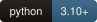
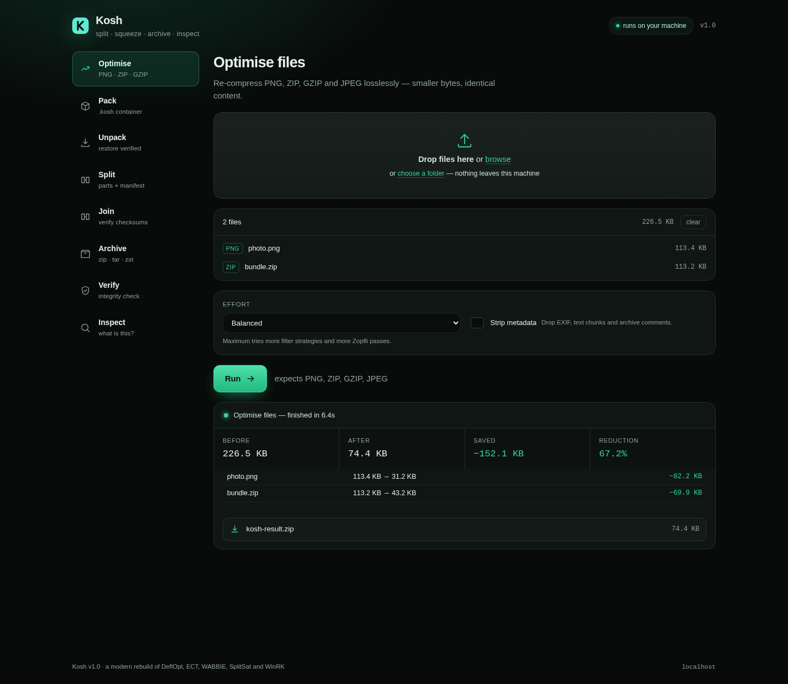

# Kosh

<p>
  
  
  
  
  
</p>

**The file workbench of the CHCE family.** Split, squeeze, archive, verify and
inspect — one engine, a CLI and a local web UI. Where a CHCE engine is installed,
Kosh drives it across a process boundary instead of reimplementing it.

```bash
kosh optimize photos/ --level 2 --strip      # PNG/ZIP/GZIP/JPEG, losslessly smaller
kosh pack project/ -o project.kosh           # verified container
kosh split backup.img --size 700M -o parts/  # parts that prove themselves
kosh verify project.kosh                     # is it intact? (no extraction)
kosh ui                                      # the same engine in a browser
```



## Where it sits in CHCE

CHCE (Holistic Compression Sources) is a source vault (`HCS`), the native engine
built from it (`ziptastic`), the orchestrator that chains binaries (`heavenzip`),
and the coordinator (`compfactory`). Kosh is the **workbench**: the thing you
point at a folder before and after the engine runs. It does not implement BWT,
rANS or PPMd, and it will not pretend to — it does container-level work that the
engine deliberately does not:

| job | who does it |
| --- | --- |
| Strongest possible ratio on a payload | `ziptastic` (`.dr`), driven by `kosh pack --engine ziptastic` |
| Chaining prebuilt binaries into a pipeline | `heavenzip` (`.hzpkg`), driven by `kosh pack --engine heavenzip` |
| Re-compressing what is already compressed (PNG, ZIP, GZIP) | **Kosh** `optimize` |
| Splitting, joining, archiving, verifying, inspecting | **Kosh** |

A CHCE stream is recognised, not decoded: `kosh scan file.dr` reports the magic,
version, original size and block count, and points at the decoder. Two tools that
both claim the same magic would be worse than one that defers.

## What it is actually good at

Format-aware, lossless re-compression. It parses the container, throws away the
redundant encoding, and rebuilds it byte-identically.

| case | before | after | cut | engine |
| --- | --- | --- | --- | --- |
| PNG saved by a fast encoder | 113,356 | 31,170 | **72.5%** | zopfli |
| Screenshot PNG, already level 6 | 4,344 | 3,727 | 14.2% | zopfli |
| `notes.txt.gz` | 1,790 | 1,080 | 39.6% | zopfli |
| ZIP of text, level 1 | 5,782 | 4,998 | 13.6% | zopfli |
| JPEG with 4 KB of EXIF | 44,514 | 43,526 | 2.2% | strip |

Pixels, archive entries, names, timestamps and order survive; only redundant
encoding and (with `--strip`) metadata go away. Every row above is reproduced by
`pytest` or by `kosh optimize` on the file described.

## Codecs, measured

`kosh bench` generates a fixed corpus (seed 20261111) and runs every codec on the
same bytes. This is the output, not a claim:

| file | raw | gzip -9 | xz -9 | zip -9 | kosh zstd 19 | kosh brotli 11 | kosh lzma 9 | best |
| --- | --- | --- | --- | --- | --- | --- | --- | --- |
| noise.bin | 1.00 MB | 1,000,328 | 1,000,108 | 1,000,426 | 1,000,471 | 1,000,445 | 1,000,545 | xz -9 |
| prose.txt | 453.68 KB | 53,462 | 46,204 | 53,560 | 46,829 | 48,591 | 46,637 | xz -9 |
| records.csv | 634.52 KB | 167,778 | 77,252 | 167,880 | 100,429 | 63,624 | 77,687 | kosh brotli 11 |
| service.log | 2.62 MB | 267,951 | 115,948 | 268,053 | 136,998 | 109,521 | 116,386 | kosh brotli 11 |

Brotli wins on records and logs; `xz` wins on prose. Kosh is a container and a
codec choice, not a new entropy coder, and the table says so. The full run, with
speeds, is in [`docs/FINDINGS.md`](docs/FINDINGS.md).

## What it is not

- **A better `xz`.** On prose it is 1.4% behind, because it is calling the same
  LZMA2. Use `ziptastic` when the last percent matters.
- **Fast at maximum.** Zopfli runs at roughly 20 KB/s on image data. Kosh uses it
  up to 1 MB of payload, then falls back to `zlib -9` and names the engine in the
  report. Level 3 overrides that up to 4 MB and can take a minute per image.
- **Lossy.** It never re-encodes a photo. It removes redundant encoding, not data.
- **A reader for `.dr` or `.hzpkg`.** It recognises the magic and defers to the
  engine that owns the format.
- **Networked.** The web UI binds to `127.0.0.1`, uploads to a local session
  directory, and makes no outbound request.

## Install

```bash
pip install -e .            # core + CLI + web UI
pip install -e ".[dev]"     # + pytest, pillow
kosh doctor                 # checks every codec with a live round-trip
```

Python 3.10+. Wheels on Linux, macOS and Windows: Typer, Rich, Zstandard,
Brotli, Zopfli, NumPy, FastAPI, Uvicorn.

## Commands

| | |
| --- | --- |
| `kosh optimize PATH…` | Re-compress PNG/GZIP/ZIP/JPEG losslessly. `--level 1–3`, `--strip`, `--dry-run`, `--backup`, `--jobs` |
| `kosh pack PATH… -o FILE` | Container with a table of contents and per-entry SHA-256. `--codec zstd\|brotli\|lzma\|store`, `--engine ziptastic\|heavenzip` |
| `kosh unpack FILE -o DIR` | Restore, verifying every entry. `--only PATH` |
| `kosh split FILE --size 700M` | Parts plus a manifest. Also `--parts N` |
| `kosh join PARTS -o FILE` | Reassemble and prove it matches the original |
| `kosh archive create/list/extract` | zip, tar, tar.gz, tar.zst, tar.xz, .kosh |
| `kosh verify FILE` | Integrity check without extraction (`--quick` for structure only) |
| `kosh info FILE` | Header, manifest digest and physical block table |
| `kosh scan FILE` | Real type by magic bytes, entropy, sample ratio; knows CHCE streams |
| `kosh bench` | Reproducible comparison against gzip -9, xz -9, zip -9 |
| `kosh doctor` | Installation self-check, including a round-trip |
| `kosh ui` | Local web interface on 127.0.0.1:8765 |

Every command takes `--json`.

## The container

`.kosh` is a CHCE-family *container*, not a CHCE bitstream: its own magic, its
own format, documented in [`docs/FORMAT.md`](docs/FORMAT.md). Blocks compress
independently so packing and unpacking parallelise; the table of contents carries
a manifest digest so damaged metadata is caught before it is trusted.

## Support


Free, offline, accountless — and staying that way. If it earned its keep:

| | |
|---|---|
| UPI (India) | `drsohilboi@ybl` — payee Dr. Sohil Momin, open amount, or scan [the QR](docs/assets/upi-qr.svg) |
| GitHub Sponsors | [github.com/sponsors/drsamonline](https://github.com/sponsors/drsamonline) |
| Ko-fi | [ko-fi.com/matneo](https://ko-fi.com/matneo) |
| PayPal | [paypal.me/drsohilmomin](https://paypal.me/drsohilmomin?locale.x=en_GB&country.x=IN) |
| My books | [Amazon author store](https://www.amazon.com/stores/author/B08ZT331LY/allbooks?ccs_id=aed72b9f-71d9-41dc-adee-e9368a317acc) |
| More apps | [drsamonline.github.io](https://drsamonline.github.io/) |
| Email | [sohilmomin2000@gmail.com](mailto:sohilmomin2000@gmail.com) |

Nothing is gated behind it: no accounts, no tracking, no network requests.

## Where to read next

| | |
|---|---|
| [`docs/ORIGINALS.md`](docs/ORIGINALS.md) | what the five Windows tools do, and what replaced them |
| [`docs/ARCHITECTURE.md`](docs/ARCHITECTURE.md) | how the engine is put together |
| [`docs/FINDINGS.md`](docs/FINDINGS.md) | every measured number, and what was rejected |
| [`docs/FORMAT.md`](docs/FORMAT.md) | the container, byte by byte |
| [`docs/ROADMAP.md`](docs/ROADMAP.md) | every planned enhancement, its exit test and its open decisions |
| [`CHANGELOG.md`](CHANGELOG.md) | what each version changed |

## Licence

MIT. See [LICENSE](LICENSE).
